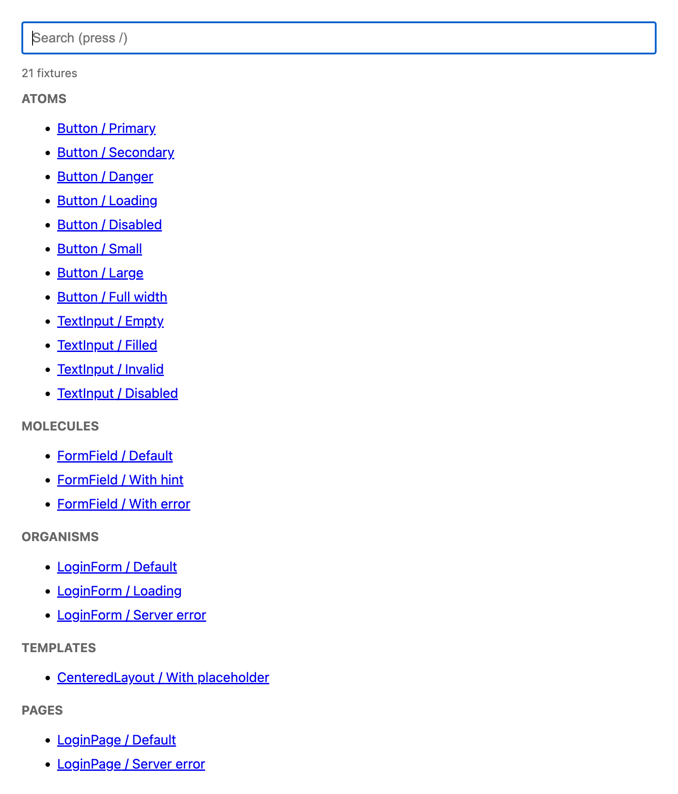
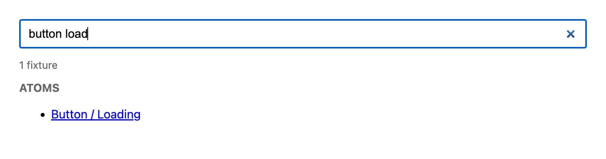
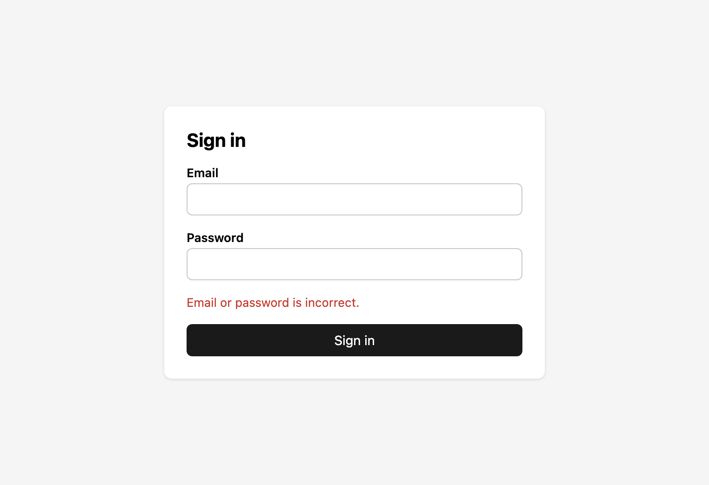

# component-catalog-blueprint

[English](README.md) | [日本語](README.ja.md) | Español | [简体中文](README.zh-CN.md)

<h1 align="center">0 packages. 0 MB.</h1>

<p align="center"><b>Cero dependencias para el catálogo. Solo la compilación de tu aplicación.</b></p>

<p align="center">
  
  
  <a href="LICENSE"></a>
</p>

Un plano para catálogos de componentes: un único conjunto de reglas que sirve para cualquier framework de front-end o motor de plantillas del lado del servidor, más una implementación de referencia que funciona.

Esto **no es una biblioteca**. No hay nada que instalar. Cada aplicación escribe su propio catálogo, pequeño, siguiendo [SPEC.md](SPEC.md).

> La versión de referencia de la especificación es [SPEC.md](SPEC.md), en inglés. Este README es una traducción. Si difiere de la versión en inglés, sigue la versión en inglés.

## Vista previa

**Índice: fixtures agrupados por nivel de atomic design, con un campo de búsqueda arriba**



**Búsqueda: `button load` encuentra `Button / Loading`**



**Un fixture por URL: `?c=LoginPage&f=Server error`**



## Uso

En la aplicación donde quieres un catálogo, dale la URL de este repositorio a tu agente de programación con IA:

> Lee https://github.com/TakakiMoriguchi/component-catalog-blueprint y crea un catálogo de componentes para esta aplicación siguiendo su SPEC.md.

El agente lee [SPEC.md](SPEC.md), revisa tu stack y usa la [guía por stack](SPEC.md#9-stack-guide) para escribir el catálogo. También puedes seguir la especificación a mano.

## Qué obtienes

- **Todos los componentes agrupados por nivel de atomic design**: `atoms`, `molecules`, `organisms`, `templates`, `pages`. La misma estructura en cada aplicación, sin importar quién añadió el componente.
- **Un campo de búsqueda en el índice del catálogo por defecto.** Escribe `button load` para encontrar `Button / Loading`.
- **Una URL por cada estado de ejemplo**: `/catalog.html?c=Button&f=Loading`. Útil para revisiones, capturas de pantalla y pruebas de regresión visual.
- **Fixtures compartidos con las pruebas.** Cada estado de ejemplo se escribe una sola vez, junto a su componente, y lo usan tanto el catálogo como las pruebas.
- **Solo en desarrollo.** El catálogo nunca llega a producción.
- **Sin nuevas dependencias** para el catálogo en sí.

## ¿Por qué no Storybook?

Las herramientas de catálogo son buenas cuando quieres una interfaz completa con controles, páginas de documentación y complementos. Muchas aplicaciones solo necesitan abrir un componente en un estado. Para eso basta una página de unas 100 líneas, que usa la compilación, los alias y las variables de entorno de la propia aplicación en lugar de un segundo proceso de compilación.

Medido en un entorno limpio (macOS arm64, número de archivos `package.json` dentro de `node_modules`):

| Configuración | Paquetes | Tamaño |
| --- | --- | --- |
| Este plano | 0 | 0 |
| react-cosmos + vite + plugin | 174 | 60 MB |
| Storybook + @storybook/react-vite + vite | 199 | 146 MB |
| Ladle | 428 | 121 MB |

Las bibliotecas de pruebas (por ejemplo `@testing-library/*`) se necesitan con cualquiera de ellas, así que no se cuentan.

Si tu aplicación ya usa una herramienta de catálogo, mantenla y aplica la especificación dentro de ella. Consulta la [sección 10 de SPEC.md](SPEC.md#10-apps-that-already-have-a-catalog-tool).

## Estructura del repositorio

```
component-catalog-blueprint/
├── SPEC.md               # Las reglas. Independientes del framework y del lenguaje.
├── examples/
│   └── bun-react/        # Implementación de referencia. Funciona por sí sola.
└── LICENSE
```

Para ejecutar el ejemplo, consulta [examples/bun-react/README.md](examples/bun-react/README.md) (en inglés).

## Contribuir

Los issues y pull requests son bienvenidos, especialmente:

- Correcciones o añadidos a la [guía por stack](SPEC.md#9-stack-guide) para los stacks que usas.
- Casos en los que las reglas de niveles de atomic design no dan una respuesta clara.

## Licencia

[MIT](LICENSE)
