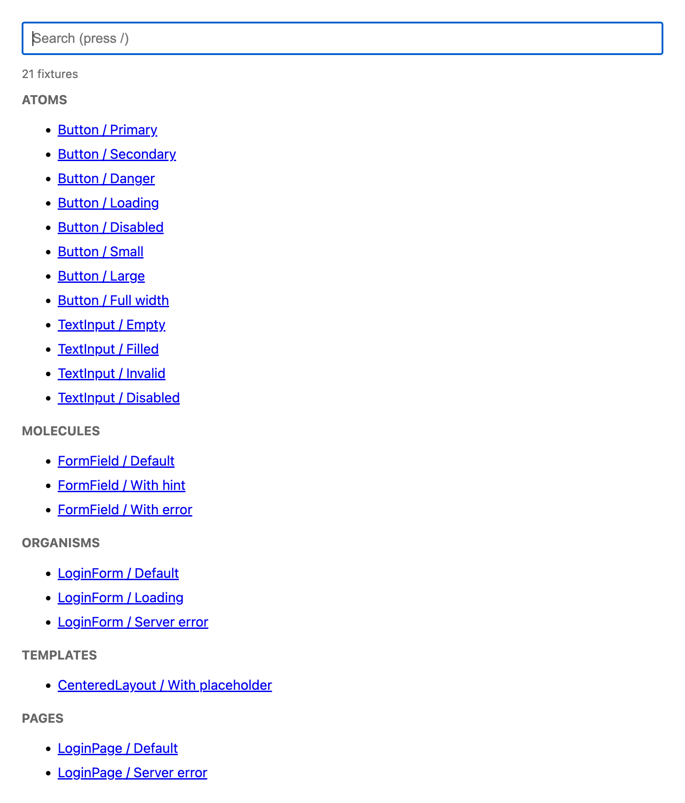
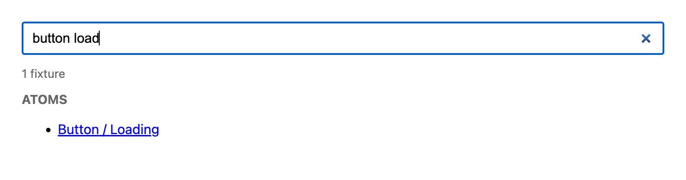
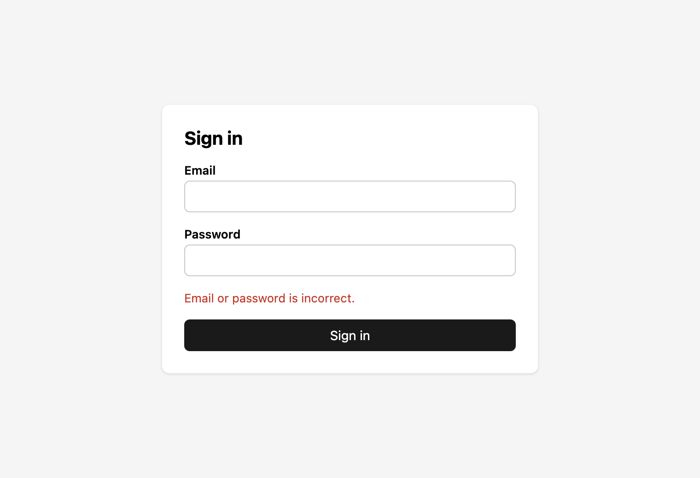

# component-catalog-blueprint

[English](README.md) | 日本語 | [Español](README.es.md) | [简体中文](README.zh-CN.md)

コンポーネントカタログの設計図です。どのフロントエンドフレームワークやサーバーサイドのテンプレートエンジンでも使える1つのルールと、動くリファレンス実装を提供します。

これは**ライブラリではありません**。インストールするものはありません。各アプリが [SPEC.md](SPEC.md) に従って、小さなカタログを自分で書きます。

> 仕様の正は英語版の [SPEC.md](SPEC.md) です。この README は翻訳で、英語版と内容が異なる場合は英語版に従ってください。

## 画面

**一覧: fixture を atomic design の階層ごとに表示し、上に検索 input を置く**



**検索: `button load` で `Button / Loading` が見つかる**



**1つの URL で1つの fixture: `?c=LoginPage&f=Server error`**



## 使い方

カタログを作りたいアプリで、AI コーディングエージェントにこのリポジトリの URL を渡します。

> https://github.com/TakakiMoriguchi/component-catalog-blueprint を読んで、その SPEC.md に従ってこのアプリにコンポーネントカタログを作成してください。

エージェントは [SPEC.md](SPEC.md) を読み、アプリのスタックを調べ、[スタック別ガイド](SPEC.md#9-stack-guide)に沿ってカタログを書きます。仕様を読んで手で作ることもできます。

## できること

- **全コンポーネントを atomic design の階層で分類**: `atoms`、`molecules`、`organisms`、`templates`、`pages`。誰がコンポーネントを足しても、どのアプリでも同じ構成になります。
- **カタログの一覧に検索 input を標準で用意。** `button load` と入力すると `Button / Loading` が見つかります。
- **表示パターンごとに1つの URL**: `/catalog.html?c=Button&f=Loading`。レビュー、スクリーンショット、ビジュアルリグレッションテストに使えます。
- **fixture をテストと共有。** 表示パターンはコンポーネントの隣に1回だけ書き、カタログとテストの両方で使います。
- **開発時だけ。** カタログは本番に含まれません。
- **カタログ自体のための依存は追加しません。**

## Storybook を使わない理由

コントロールパネル、ドキュメントページ、アドオンなどの豊富な UI が欲しいなら、専用ツールが向いています。多くのアプリでは、1つのコンポーネントを1つの状態で開ければ十分です。それなら100行ほどのページで足ります。ビルドの経路を2本持たず、アプリ自身のビルド、alias、環境変数をそのまま使えます。

クリーンな環境での実測（macOS arm64、`node_modules` 配下の `package.json` の数）:

| 構成 | パッケージ数 | サイズ |
| --- | --- | --- |
| この設計図 | 0 | 0 |
| react-cosmos + vite + plugin | 174 | 60 MB |
| Storybook + @storybook/react-vite + vite | 199 | 146 MB |
| Ladle | 428 | 121 MB |

テスト用のライブラリ（`@testing-library/*` など）はどの構成でも必要なので、数に含めていません。

アプリで既にカタログツールを使っている場合は、そのまま使い続け、その中で仕様に合わせてください。[SPEC.md の10節](SPEC.md#10-apps-that-already-have-a-catalog-tool)を参照してください。

## リポジトリの構成

```
component-catalog-blueprint/
├── SPEC.md               # ルール本体。フレームワークや言語に依存しない
├── examples/
│   └── bun-react/        # リファレンス実装。単独で動く
└── LICENSE
```

サンプルの動かし方は [examples/bun-react/README.md](examples/bun-react/README.md) を参照してください（英語）。

## コントリビュート

issue や pull request を歓迎します。特に次のものを歓迎します。

- 普段使っているスタックについての、[スタック別ガイド](SPEC.md#9-stack-guide)の修正や追加
- atomic design の階層のルールで、答えがはっきりしないケース

## ライセンス

[MIT](LICENSE)
