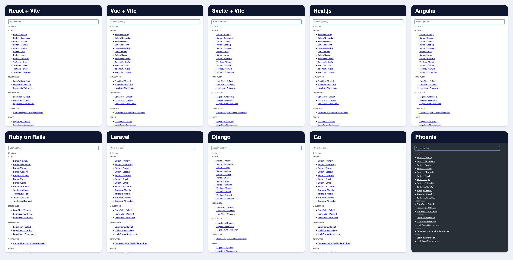

# component-catalog-blueprint

English | [日本語](README.ja.md) | [Español](README.es.md) | [简体中文](README.zh-CN.md)

<h1 align="center">0 packages. 0 MB.</h1>

<p align="center"><b>Zero dependencies for the catalog. Your app's own build. Nothing else.</b></p>

<p align="center">
  
  
  <a href="LICENSE"></a>
</p>

A blueprint for component catalogs: one set of rules that works for any front-end framework or server-side template engine, plus a working reference implementation.

This is **not a library**. There is nothing to install. Each app writes its own small catalog by following [SPEC.md](SPEC.md).

## Preview

**The same catalog in 10 stacks: fixtures grouped by atomic level, with a search input on top**

<p align="center">
  
  
  
  
  
  
  
  
  
  
  
  
  
</p>



**Search: `button load` finds `Button / Loading`**


**One fixture per URL: `?c=LoginPage&f=Server error`**


## Use it

Give this repository's URL to your AI coding agent in the app where you want a catalog:

> Read https://github.com/TakakiMoriguchi/component-catalog-blueprint and build a component catalog for this app that follows its SPEC.md.

The agent reads [SPEC.md](SPEC.md), checks your stack, and uses the [stack guide](SPEC.md#9-stack-guide) to write the catalog. You can also follow the spec by hand.

## What you get

- **Every component grouped by atomic design level**: `atoms`, `molecules`, `organisms`, `templates`, `pages`. The same structure in every app, no matter who added the component.
- **A search input on the catalog index by default.** Type `button load` to find `Button / Loading`.
- **One URL per example state**: `/catalog.html?c=Button&f=Loading`. Useful for reviews, screenshots, and visual regression tests.
- **Fixtures shared with tests.** Each example state is written once, next to its component, and used by both the catalog and the tests.
- **Development only.** The catalog never ships to production.
- **No new dependencies** for the catalog itself.

## Why not Storybook?

Catalog tools are good when you want a rich UI with controls, docs pages, and add-ons. Many apps only need to open one component in one state. For that, a page of about 100 lines is enough, and it uses the app's own build, aliases, and environment variables instead of a second build pipeline.

Measured in a clean environment (macOS arm64, number of `package.json` files under `node_modules`):

| Setup | Packages | Size |
| --- | --- | --- |
| This blueprint | 0 | 0 |
| react-cosmos + vite + plugin | 174 | 60 MB |
| Storybook + @storybook/react-vite + vite | 199 | 146 MB |
| Ladle | 428 | 121 MB |

Test libraries (for example `@testing-library/*`) are needed with any of these, so they are not counted.

If your app already uses a catalog tool, keep it and apply the spec inside it. See [SPEC.md section 10](SPEC.md#10-apps-that-already-have-a-catalog-tool).

## Repository layout

```
component-catalog-blueprint/
├── SPEC.md               # The rules. Framework and language independent.
├── examples/
│   └── bun-react/        # Reference implementation. Runs on its own.
└── LICENSE
```

To run the example, see [examples/bun-react/README.md](examples/bun-react/README.md).

## Contributing

Issues and pull requests are welcome, especially:

- Corrections or additions to the [stack guide](SPEC.md#9-stack-guide) for stacks you use.
- Cases where the atomic level rules give an unclear answer.

## License

[MIT](LICENSE)
