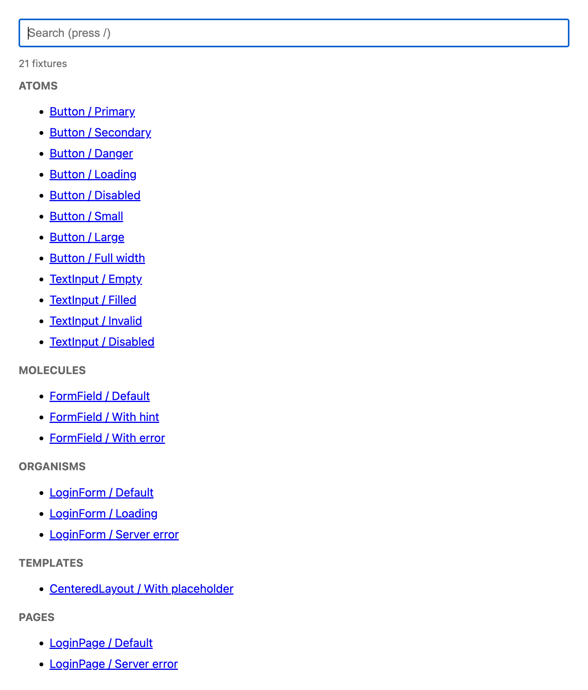
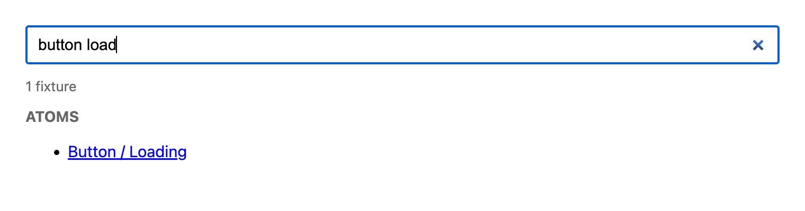
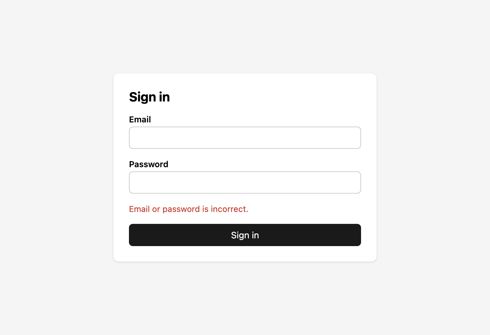

# component-catalog-blueprint

[English](README.md) | [日本語](README.ja.md) | [Español](README.es.md) | 简体中文

组件目录的设计蓝图：一套适用于任何前端框架或服务端模板引擎的规则，外加一个可运行的参考实现。

这**不是一个库**，没有需要安装的东西。每个应用按照 [SPEC.md](SPEC.md) 自己编写一个小型目录。

> 规范以英文版 [SPEC.md](SPEC.md) 为准。本 README 为译文，如与英文版不一致，请以英文版为准。

## 预览

**索引：fixture 按 atomic design 层级分组，顶部是搜索框**



**搜索：输入 `button load` 找到 `Button / Loading`**



**每个 fixture 对应一个 URL：`?c=LoginPage&f=Server error`**



## 使用方法

在需要组件目录的应用中，把本仓库的 URL 交给你的 AI 编程助手：

> 阅读 https://github.com/TakakiMoriguchi/component-catalog-blueprint ，并按照其中的 SPEC.md 为这个应用创建组件目录。

助手会阅读 [SPEC.md](SPEC.md)，检查你的技术栈，并按照[技术栈指南](SPEC.md#9-stack-guide)编写目录。你也可以手动按照规范来实现。

## 你能得到什么

- **所有组件按 atomic design 层级分组**：`atoms`、`molecules`、`organisms`、`templates`、`pages`。无论是谁添加的组件，每个应用都是相同的结构。
- **目录索引默认带有搜索框。** 输入 `button load` 即可找到 `Button / Loading`。
- **每个示例状态对应一个 URL**：`/catalog.html?c=Button&f=Loading`。可用于评审、截图和视觉回归测试。
- **fixture 与测试共享。** 每个示例状态只在组件旁边写一次，目录和测试都会使用它。
- **仅限开发环境。** 目录永远不会进入生产环境。
- **目录本身不添加任何新依赖。**

## 为什么不用 Storybook？

如果你需要带有控件、文档页面和插件的丰富界面，目录工具是不错的选择。但很多应用只需要以某个状态打开某个组件。为此，一个约 100 行的页面就足够了。它直接使用应用自身的构建、路径别名和环境变量，而不需要第二条构建流程。

在干净环境中的实测（macOS arm64，`node_modules` 下 `package.json` 文件的数量）：

| 方案 | 包数量 | 大小 |
| --- | --- | --- |
| 本蓝图 | 0 | 0 |
| react-cosmos + vite + plugin | 174 | 60 MB |
| Storybook + @storybook/react-vite + vite | 199 | 146 MB |
| Ladle | 428 | 121 MB |

测试库（例如 `@testing-library/*`）在任何方案中都需要，因此不计入。

如果你的应用已经在使用目录工具，请继续使用，并在其中应用本规范。参见 [SPEC.md 第 10 节](SPEC.md#10-apps-that-already-have-a-catalog-tool)。

## 仓库结构

```
component-catalog-blueprint/
├── SPEC.md               # 规则本身，与框架和语言无关
├── examples/
│   └── bun-react/        # 参考实现，可独立运行
└── LICENSE
```

运行示例请参见 [examples/bun-react/README.md](examples/bun-react/README.md)（英文）。

## 参与贡献

欢迎提交 issue 和 pull request，尤其是：

- 针对你所使用的技术栈，对[技术栈指南](SPEC.md#9-stack-guide)的修正或补充。
- atomic design 层级规则无法给出明确答案的情况。

## 许可证

[MIT](LICENSE)
